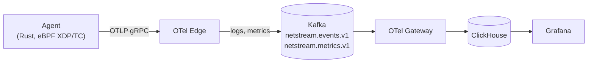
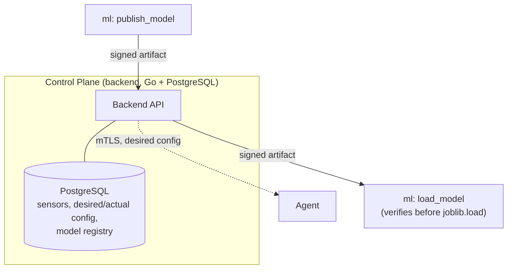

# Архитектура системы

NetStream-Core — система детектирования сетевых атак: eBPF-сенсор на хосте, телеметрия по OTLP через Kafka в ClickHouse, дашборды в Grafana, офлайн-обучение моделей в отдельном ML-конвейере, control plane на Go/PostgreSQL и детектор реального времени, читающий тот же Kafka-поток параллельно ClickHouse. Ниже — то, что реально построено, работает и проверено на реальной инфраструктуре; раздел «Дальше» в конце — то, что осознанно не сделано.

## Data plane

### Узлы (компоненты)

- **Agent** (репозиторий `agent`, Rust): XDP-программа на входе и TC-программа на выходе интерфейса разбирают пакеты и DNS-запросы в ядре, агрегируют потоки с бюджетом на новые записи (защита от флуда), проверяют DNS по блок-листу (hot-reload без перезапуска) и по решению отвечают — только наблюдают, дропают запрос или дропают и ставят источник в карантин. Пользовательская часть на Rust периодически снимает счётчики из eBPF-карт и отправляет их по OTLP (опционально поверх TLS, см. «Control plane» ниже — та же модель, серверный TLS без аутентификации агента на этом пути). eBPF-объект встроен в бинарник агента — разворачивается один файл, без отдельного `.o`.
- **OTel Edge**: приёмник OTLP от агентов, пишет логи и метрики в Kafka. Разделение по сигналам — `netstream.events.v1` (потоки, DNS, срабатывания блоклиста) и `netstream.metrics.v1` (накладные расходы самого агента). Приём можно включить с TLS (`deploy/README.md`, раздел «TLS»).
- **Kafka**: буфер и точка развязки между приёмом телеметрии и её хранением — позволяет пережить недоступность ClickHouse без потери данных и читать тот же поток параллельно: `netstream.events.v1` читают одновременно OTel Gateway (своя consumer group) и Detector (своя, см. ниже) — независимо друг от друга.
- **OTel Gateway**: читает Kafka, пишет в ClickHouse через `clickhouseexporter`.
- **ClickHouse**: основное телеметрийное хранилище. Сырые OTLP-записи (`otel_logs`, `otel_metrics_*`) живут недолго (TTL 3 дня) и материализованными представлениями превращаются в типизированные таблицы с более долгим хранением: `flows`, `dns_queries`, `blocklist_hits`, агрегаты `flows_1m`, метрики агента `agent_metrics`, детекции `detections` (заполняется напрямую из Kafka через `Kafka`-движок + materialized view, см. «Детектор» ниже — без участия OTel Gateway). Точную схему и историю миграций см. в `deploy/clickhouse/migrations` и `deploy/README.md`.
- **Grafana**: дашборды поверх ClickHouse через read-only учётную запись (не может ничего испортить, даже если кто-то допишет `DROP` в панель).

### Идентичность и время события

Каждое событие несёт `service.instance.id` (`boot_id` — меняется при каждом перезапуске агента), монотонный `netstream.event.sequence` и производный от них `netstream.event.id` — этого достаточно, чтобы отличить повторную доставку одного события (Kafka retry) от нового события, без отдельного генератора UUID. Раздельные `event_time` (когда агент сформировал запись) и `ingest_time` (когда строка попала в ClickHouse, `DEFAULT now()`) отвечают на вопрос «задержка обнаружения — 8 секунд или 800 миллисекунд», который при одной временной оси задать было бы нельзя. Подробности — в `deploy/README.md`, раздел «Идентичность события».

### ML-конвейер (офлайн, отдельно от data plane выше)

Репозиторий `ml` выгружает размеченные данные из ClickHouse (лаборатория `deploy/lab` генерирует атаки и доброкачественный трафик с манифестом кампании), строит оконные признаки по источнику (пакеты, TCP-флаги, распределение размеров, DNS-энтропия и т.д. — одна и та же спецификация в виде быстрого batch-конвейера для обучения и `WindowAccumulator`, инкрементального аккумулятора, которым пользуется и Detector ниже), обучает и честно сравнивает baseline-модели (пороговые правила, Isolation Forest, Random Forest, XGBoost с подбором гиперпараметров) через общий фреймворк оценки (PR-кривые, разброс по seed, тест Макнемара), экспортирует обученную модель в ONNX или публикует её в реестре моделей backend (подписанный Ed25519 артефакт, см. «Control plane» ниже). Всё это работает сегодня и воспроизводимо на реальных данных лаборатории — подробности и текущие числа в `ml/README.md`.

## Control plane

Принцип разделения: **control plane управляет data plane, но не является его частью**. Агент не зависит от backend для работы — если backend недоступен, агент продолжает захват, агрегацию и применение уже полученного (последнего known-good) конфига блок-листа; и наоборот, падение агента не останавливает приём и хранение телеметрии от остальных сенсоров.

- **Реестр сенсоров и конфигурация**: агент регистрируется, сравнивает версию desired-конфига с локальной и подтягивает разницу целиком, а не применяет команды по одной; подтверждает применение (`actual_config_version`) отдельно от того, какие именно поля реально хот-эплайнулись (`actual_config_unapplied_fields`) — backend проверяет, что подтверждаемая версия реально существовала и не превышает текущую desired, а не просто берёт `GREATEST` вслепую.
- **Аутентификация — mTLS**: `CommonName` клиентского сертификата — идентификатор вызывающего (`host_id` сенсора или имя оператора); роль и выпуск сертификатов — см. «RBAC и выпуск сертификатов» ниже.
- **Реестр моделей**: метаданные (метрики, версия признаков, `sha256` + подпись Ed25519 артефакта) в PostgreSQL, сам артефакт — в объектном хранилище (SeaweedFS, S3-совместимое); backend хранит подпись, но не проверяет её (нет приватного ключа) — проверяет `ml` на `load_model`, до `joblib.load`. Состояние control plane — в PostgreSQL, а не в ClickHouse: пользователи, конфиги и метаданные моделей не пишутся построчно в MergeTree-таблицу, для которой она не предназначена.

## Детектор реального времени (Detector)

Репозиторий `ml`, `netstream_ml.detector` (`detect run`) — подписан на тот же `netstream.events.v1`, что и OTel Gateway, своей consumer group, независимо от того, успел ли ClickHouse записать событие. ClickHouse в latency-critical пути детектирования не участвует — читает уже готовые детекции отдельно (ниже), а не обслуживает путь между сенсором и алертом.

- Кормит те же оконные признаки (`WindowAccumulator`), что и офлайн-обучение, обученной baseline-моделью (ONNX-файл или подписанный артефакт из реестра моделей backend) и публикует результат каждого закрывшегося окна в `netstream.detections.v1`.
- Входной офсет коммитится вручную, только после того как публикация детекции подтверждена брокером (`enable.auto.commit=false` + idempotent producer) — падение между чтением и публикацией не теряет детекцию молча, в худшем случае переобрабатывает то же окно повторно (стабильный ключ `host_id:src_ip:window_start:window_seconds` на сообщении позволяет дедуплицировать ниже по потоку).
- `netstream.detections.v1` читает ClickHouse напрямую — `Kafka`-движок + materialized view в таблицу `detections` (без OTel Gateway), дашборд `NetStream / Detections` строится на ней.
- Проверено на реальной инфраструктуре (`deploy/tests/e2e/detection.sh`): публикация модели → `detect run` → синтетическое окно через edge → детекция в ClickHouse; перезапуск детектора не теряет и не дублирует уже обработанное окно (consumer group резюмирует с закоммиченного офсета); кратковременная недоступность Kafka не роняет процесс — после восстановления брокера детектирование продолжается без ручного вмешательства.

## Инциденты

`backend`'s `internal/incidents`/`internal/detections` (см. его README, раздел «Инциденты») — своя consumer group на `netstream.detections.v1`, не конкурирует ни с ClickHouse, ни с `ml`. Детекция с `is_attack: true` продлевает уже открытый инцидент по той же паре `(host_id, src_ip)` (если он не старше 5 минут) или открывает новый; открытие нового публикует алерт в `netstream.alerts.v1` — один раз на инцидент, не на каждую детекцию. Оператор видит и закрывает инциденты через `GET/PUT /api/v1/incidents`. Это не Correlation Engine (см. «Дальше» ниже) — минимум, без которого «детект → блок» заканчивается на сыром потоке детекций.

## RBAC и выпуск сертификатов

`backend` различает три роли по mTLS-сертификату (`OrganizationalUnit`): `operator` (полный доступ), `operator-readonly` (чтение без изменений — наблюдатель/дашборд/аудитор) и сенсор (ограничен собственным `host_id`). Оператор также может подписать CSR сенсора собственным CA backend'а (`internal/pki`) — сенсор сам генерирует ключевую пару и CSR, приватный ключ никуда не передаётся; выпуск отдельно отслеживается в `sensor_certificates` (serial, срок действия, отзыв). Подробности и проверенные вживую сценарии — `backend/README.md`, разделы «mTLS» и «Выпуск сертификатов сенсоров».

## Дальше (осознанно не сделано)

- **Более гранулярные права внутри роли оператора**, чем просто чтение/запись (`operator-readonly` закрывает базовый случай «наблюдатель», не произвольную матрицу прав — например, «может закрывать инциденты, но не публиковать модели» отдельно не разграничено).
- **Correlation Engine** как отдельный сервис (кластеризация между хостами, подавление дублей по правилам), кластеризация Kafka/ClickHouse, HA-профили, SLO как формальный документ — архитектура production-эксплуатации, не то, что нужно для защиты диплома с рабочим замкнутым циклом «детект → блок» на одной машине.
- **Применение отзыва сертификата на TLS-хендшейке** (CRL/OCSP) — отзыв сейчас запись в базе для оператора, а не контроль: Go `tls.Config` не даёт точки интеграции для этого при `RequireAndVerifyClientCert`, отозванный сертификат продолжает проходить аутентификацию до истечения срока действия.

Если проект продолжится после защиты как реальный сервис — это отдельный следующий этап, не текущий.
